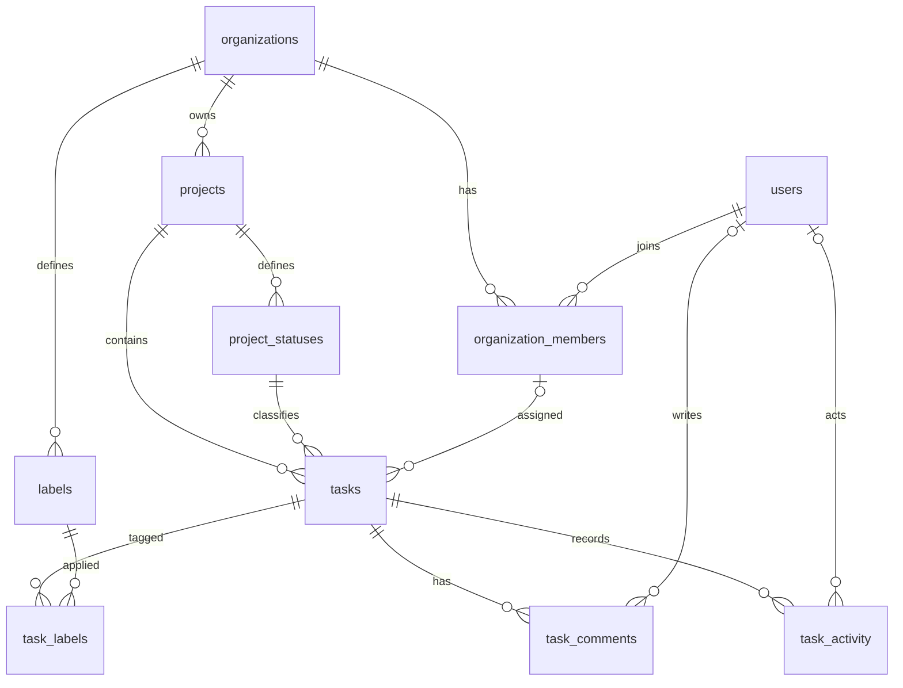

# Task Platform Data Model: Technical Documentation

Source of truth: [`schema.sql`](schema.sql) (PostgreSQL 16) and [`schema.graphql`](schema.graphql). Part 2 applies the same SQL as migration `001_init.sql`.

## 1. Data model rationale

An **organization** (workspace) is the tenant boundary. Users are global and join organizations through **organization_members**, which holds the RBAC role. Every other table stores the `org_id` it belongs to.



- **Custom statuses with a fixed category.** Each project defines its own `project_statuses`, and each one maps to `todo`, `in_progress` or `done`. "Overdue" and "completed" then mean the same thing in every project.
- **Workspace settings as `jsonb`** on `organizations`, constrained to a JSON object. A new setting needs no migration; the API validates the shape.
- **Append-only activity**, one row per changed field (`field`, `old_value`, `new_value` as `jsonb`, since fields differ in type). A `bigint` identity key gives a cheap, monotonic pagination order.
- **The assignee references the membership**, `(org_id, assignee_id) → organization_members`. Tasks can only be assigned within their organization, and removing a member unassigns their tasks.

Role permissions, enforced in resolvers and annotated on each mutation in `schema.graphql`:

| Action | owner | admin | member | viewer |
|---|---|---|---|---|
| Read projects, tasks, comments, activity | yes | yes | yes | yes |
| Create, update or delete tasks; comment; create labels | yes | yes | yes | no |
| Manage projects, statuses, members, settings | yes | yes | no | no |
| Grant or revoke the owner role | yes | no | no | no |

## 2. Query patterns

Each request first loads the caller's memberships (`SELECT org_id, role FROM organization_members WHERE user_id = $1`, answered from one index). The resulting `org_id` list scopes every later query.

**Overdue tasks assigned to me, across projects.** No membership join is needed: the `(org_id, assignee_id)` foreign key guarantees the assignee belongs to the task's organization.

```sql
-- $1 = current user id
SELECT t.id, t.title, t.priority, t.due_date,
       p.id AS project_id, p.name AS project_name, s.name AS status_name
FROM tasks t
JOIN project_statuses s ON s.id = t.status_id
JOIN projects p         ON p.id = t.project_id
WHERE t.assignee_id = $1
  AND t.due_date < current_date
  AND s.category <> 'done'
  AND p.archived_at IS NULL
ORDER BY t.due_date, t.id
LIMIT 50;
```

**Task board page.** Only filters that are set add a predicate. Keyset order is `(created_at, id)` with `id` as the tiebreaker; one extra row gives `hasNextPage`. With no `OFFSET`, a deep page costs the same as the first.

```sql
SELECT t.id, t.title, t.priority, t.status_id, t.assignee_id, t.due_date, t.created_at
FROM tasks t
WHERE t.project_id = $1
  AND t.org_id = ANY($2)               -- organizations the caller belongs to
  AND t.status_id = ANY($3)            -- only when the status filter is set
  AND t.priority = ANY($4)             -- only when the priority filter is set
  AND (t.created_at, t.id) < ($5, $6)  -- cursor; omitted on the first page
ORDER BY t.created_at DESC, t.id DESC
LIMIT $7;                              -- page size + 1
```

**Board summary in one scan.** `GROUPING SETS` counts by status, priority and assignee, plus the total, in a single pass.

```sql
SELECT t.status_id, t.priority, t.assignee_id,
       GROUPING(t.status_id, t.priority, t.assignee_id) AS grouping_set,
       count(*) AS total,
       count(*) FILTER (WHERE t.due_date < current_date AND s.category <> 'done') AS overdue
FROM tasks t
JOIN project_statuses s ON s.id = t.status_id
WHERE t.project_id = $1
  AND t.org_id = ANY($2)
GROUP BY GROUPING SETS ((t.status_id), (t.priority), (t.assignee_id), ());
```

**Task updates and activity.** A single statement updates the task and writes its activity row: a CTE reads the old value `FOR UPDATE`, updates the row, and inserts into `task_activity` only where the value actually changed. The change and its history cannot drift apart.

## 3. Indexing strategy and performance

Indexes follow the queries above. Tenant foreign keys are indexed on the referencing side; foreign keys to `users` are not yet (see [`ai-critique.md`](ai-critique.md)).

| Index | Serves |
|---|---|
| `organization_members (user_id) INCLUDE (org_id, role)` | Per-request membership load |
| `tasks (project_id, created_at DESC, id DESC)` | Board order and keyset cursor |
| `tasks (project_id, status_id)` | Status filter, summary, status FK |
| `tasks (project_id, assignee_id)` | Assignee filter within a project |
| `tasks (assignee_id, due_date)` | "My overdue tasks"; member removal |
| `task_labels (label_id)`; `(task_id, ...)` on comments and activity | Label lookups, per-task feeds |

- **Keyset pagination**: cost depends on the page size, not the page number, and pages stay stable when rows are inserted in between.
- **No N+1**: `Task.assignee`, `Task.status` and `Task.labels` resolve through per-request DataLoaders, so a 50-task page is one query per relation.
- **Computed aggregates**: the summary takes about 5 ms for a 2,500-task project in local testing, so there are no denormalized counters to keep consistent.

## 4. Multi-tenancy isolation

Shared database, shared schema, `org_id` on every tenant table. For hundreds of unevenly sized organizations, schema- or database-per-tenant adds operational cost without a matching benefit. Isolation has three layers:

1. **Request scope.** Memberships are loaded once per request (the dev build identifies the user by an `x-user-id` header), and every query is scoped by `org_id = ANY(...)`. Another tenant's ID returns nothing, so the row's existence does not leak.
2. **Role checks** on writes, using the same membership row.
3. **Database constraints.** Every reference between tenant rows is a composite foreign key that includes `org_id`. A task cannot point at another organization's project, status, label or member even if resolver code is wrong; each case was tested and rejected.

Not yet in place: PostgreSQL Row-Level Security, a fourth layer independent of resolver code, to add before the platform holds sensitive data.

## 5. Migration strategy

- **Forward-only numbered SQL files** (`001_init.sql`, `002_...`), recorded in a `schema_migrations` table. The runner applies each file in one transaction, so a failure leaves no partial state.
- **Expand, migrate, contract** for breaking changes. Add the new structure, deploy code that writes to both and reads the new one, backfill in batches, then drop the old structure in a later release. Each step can be rolled back on its own.
- **Lock-aware DDL.** Add columns as nullable or with a constant default (a metadata-only change). Build indexes `CONCURRENTLY` in their own migration, outside a transaction. Add constraints `NOT VALID` and validate them later under a weaker lock. For example, adding a `blocked` category:

```sql
ALTER TABLE project_statuses
    ADD CONSTRAINT project_statuses_category_check_v2
    CHECK (category IN ('todo', 'in_progress', 'blocked', 'done')) NOT VALID;
ALTER TABLE project_statuses DROP CONSTRAINT project_statuses_category_check;
-- Next migration: scans existing rows without blocking writes.
ALTER TABLE project_statuses VALIDATE CONSTRAINT project_statuses_category_check_v2;
```

- **Settings evolve without DDL:** new keys get defaults in code; renamed keys are backfilled with `jsonb_set`.
